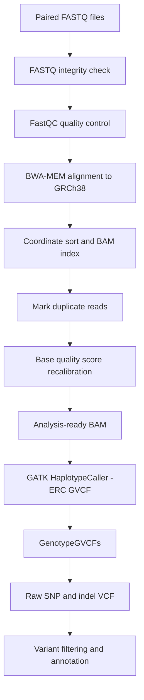

# Human Germline Variant Calling Pipeline

A reproducible, command-line workflow for processing paired-end human whole-genome sequencing reads and discovering germline short variants (SNPs and small indels) with BWA-MEM and GATK.

> **Project status:** Workflow template / in progress. Do not describe this pipeline as completed or validated until the commands have been run successfully and the output files and QC metrics have been inspected.

## Project dataset

| Field | Value |
|---|---|
| Sample | `HG00096` |
| Sequencing run | `SRR062634` |
| Source | 1000 Genomes Project Phase 3 FTP |
| Read layout | Paired-end (`_1` and `_2`) |
| Reference build | GRCh38 / Broad `Homo_sapiens_assembly38` |
| Aligner | BWA-MEM |
| Variant caller | GATK HaplotypeCaller |

Read files:

- `SRR062634_1.filt.fastq.gz`
- `SRR062634_2.filt.fastq.gz`

Source directory: [1000 Genomes Project read data](https://ftp-trace.ncbi.nih.gov/1000genomes/ftp/phase3/data/HG00096/sequence_read/)

## Workflow overview



## Repository layout

```text
human-germline-variant-calling/
├── README.md
├── .gitignore
└── scripts/
    ├── config.sh
    ├── 01_download_reads.sh
    ├── 02_prepare_reference.sh
    ├── 03_qc_and_align.sh
    ├── 04_mark_duplicates_and_bqsr.sh
    └── 05_call_variants.sh
```

The scripts use paths relative to this repository, so the project can be moved without editing multiple absolute paths. Set `PROJECT_DIR`, `THREADS` or `JAVA_MEM` in your environment to override the defaults.

## Requirements

- Linux (Ubuntu recommended)
- `wget`, `gzip`
- BWA
- FastQC
- SAMtools
- BCFtools
- GATK 4
- Java version supported by the installed GATK release

Check availability before starting:

```bash
for tool in wget gzip bwa fastqc samtools bcftools gatk; do
    command -v "$tool" || echo "MISSING: $tool"
done

bwa 2>&1 | head -n 3
samtools --version | head -n 2
gatk --version
fastqc --version
```

Record the actual software versions used in `docs/software-versions.txt` or in the final report. Do not copy version numbers from another machine.

## Reference genome and known sites

This project uses the Broad Institute GRCh38 resource bundle so that the reference sequence and BQSR known-sites VCF come from the same resource collection.

The preparation script downloads:

- `Homo_sapiens_assembly38.fasta`
- `Homo_sapiens_assembly38.dbsnp138.vcf`
- `Homo_sapiens_assembly38.dbsnp138.vcf.idx`

It then generates the FASTA `.fai`, GATK `.dict` and BWA index locally. These indexes are reusable for other samples aligned to this exact reference. Keep all reference files together in `reference/`.

**Do not mix the UCSC `hg38.fa` with Broad assembly38 known-sites files without first verifying sequence/contig compatibility.** Different GRCh38 resource packages can differ in contig naming and included sequences. Reference, alignment index, sequence dictionary and known-sites resources must be compatible.

## Run the workflow

Run from the repository root. Make scripts executable once:

```bash
chmod +x scripts/*.sh
```

### 1. Create project directories

```bash
source scripts/config.sh
mkdir -p "$READS_DIR" "$QC_DIR" "$ALIGNED_DIR" "$RESULTS_DIR" "$REFERENCE_DIR" "$DATA_DIR" "$LOG_DIR"
```

### 2. Download paired-end reads

```bash
./scripts/01_download_reads.sh
```

Downloads are resumable (`wget -c`). The script checks both compressed FASTQ files with `gzip -t` before continuing. It does not decompress them.

### 3. Prepare reference resources

```bash
./scripts/02_prepare_reference.sh
```

This is a one-time step for this exact reference build. It creates the SAMtools FASTA index, GATK sequence dictionary and BWA index. Indexing a whole human reference can take substantial time and RAM.

### 4. Run FastQC and align reads

```bash
./scripts/03_qc_and_align.sh
```

FastQC accepts gzip-compressed FASTQ files, so decompression is not required. Inspect the HTML reports before deciding whether adapter or quality trimming is necessary. Do not assume that trimming is unnecessary until the reports have been reviewed.

BWA-MEM writes to SAM; this script pipes the output directly into `samtools sort` to create a coordinate-sorted BAM without storing a very large intermediate SAM file. It adds read-group metadata during alignment.

For this dataset the sample name is `HG00096`; `SRR062634` is the sequencing-run identifier. The `LB` value in `config.sh` is a project label and should be replaced with the actual library identifier if it is available from the sequencing metadata. `PU` should likewise represent the actual platform unit / flowcell-lane information when known. Do not invent sequencing metadata for a production analysis.

### 5. Mark duplicates and perform BQSR

```bash
./scripts/04_mark_duplicates_and_bqsr.sh
```

The script marks PCR/optical duplicate reads, indexes the BAM, runs `BaseRecalibrator` using the dbSNP known-sites resource and applies the resulting recalibration table.

BQSR is not a substitute for checking read quality. Its usefulness depends on appropriate known-sites resources and sequencing context. Keep the original and recalibrated BAMs until QC is complete.

### 6. Call variants

```bash
./scripts/05_call_variants.sh
```

HaplotypeCaller runs in GVCF mode (`-ERC GVCF`). `GenotypeGVCFs` then genotypes the single-sample GVCF and creates a raw VCF. A raw VCF is **not** a clinically interpreted or reportable result.

For a multi-sample study, generate one GVCF per sample and follow the GATK joint-genotyping workflow rather than treating each sample's raw VCF as the final cohort callset.

## Output files

| Output | Purpose |
|---|---|
| `qc/fastqc/` | FastQC HTML and ZIP reports |
| `aligned_reads/HG00096.sorted.bam` | Coordinate-sorted alignment before duplicate marking |
| `aligned_reads/HG00096.markdup.bam` | Duplicate-marked BAM |
| `aligned_reads/HG00096.recal.bam` | BQSR-applied analysis-ready BAM |
| `results/HG00096.g.vcf.gz` | HaplotypeCaller single-sample GVCF |
| `results/HG00096.raw.vcf.gz` | Genotyped raw variant VCF |
| `results/HG00096.raw.vcf.gz.tbi` | Tabix index for the raw VCF |

## Validation and QC checklist

- [ ] Both FASTQ downloads completed and pass `gzip -t`.
- [ ] FastQC reports reviewed; any trimming decision documented.
- [ ] Reference FASTA, FASTA index, sequence dictionary and BWA index all correspond to the same assembly.
- [ ] BWA alignment completed and BAM is coordinate-sorted.
- [ ] Read groups are present and sample name is correct (`SM:HG00096`).
- [ ] `samtools quickcheck` passes for each final BAM.
- [ ] Duplicate metrics reviewed.
- [ ] BQSR recalibration table generated and recalibrated BAM indexed.
- [ ] GVCF and VCF files are non-empty, indexed where required, and pass validation.
- [ ] Variant counts, Ti/Tv, depth and other QC metrics are reported with the relevant caveats.
- [ ] Filtering and annotation methods are documented separately from raw variant calling.

Useful checks:

```bash
samtools view -H aligned_reads/HG00096.sorted.bam | grep '^@RG'
samtools flagstat aligned_reads/HG00096.recal.bam
samtools quickcheck -v aligned_reads/HG00096.recal.bam
bcftools stats results/HG00096.raw.vcf.gz > results/HG00096.vcf.stats.txt
```

The final `bcftools stats` command requires `bcftools` to be installed.

## Resource considerations

Human whole-genome data are computationally and storage intensive. The reference and its BWA index, FASTQ files, sorted/marked/recalibrated BAMs and temporary files can require substantial disk space. BWA indexing and GATK processing may exceed the practical limits of a small VirtualBox VM. On an 8 GB host, use conservative thread and Java-memory settings, keep adequate disk space available, and expect long runtimes. For reliable whole-genome processing, a machine or cloud VM with more RAM (often 16 GB or more) is more appropriate. Do not allocate all host RAM to the VM.

The included defaults (`THREADS=2`, `JAVA_MEM=3g`) are conservative starting points, not guaranteed performance settings. Monitor memory and disk usage.

## Important limitations

- This is a learning / research workflow, not a validated clinical diagnostic pipeline.
- The included scripts have not been executed in your environment. Validate every tool version, URL, input file and output before interpreting results.
- BWA-MEM soft clipping is an alignment behaviour; it does not replace FastQC review or adapter assessment.
- Short reads can be difficult to map uniquely in repetitive or homologous regions. Mapping quality and coverage should be assessed.
- Variant filtering thresholds depend on the assay, coverage, sample count and intended downstream use. Do not apply generic hard filters blindly.
- ACMG/AMP classification requires clinical context, transcript selection, evidence review and expert interpretation; a VCF alone does not establish pathogenicity.

## References

1. [GATK Best Practices: data pre-processing for variant discovery](https://gatk.broadinstitute.org/hc/en-us/articles/360035535912-Data-pre-processing-for-variant-discovery)
2. [GATK Best Practices: germline short variant discovery](https://gatk.broadinstitute.org/hc/en-us/articles/360035535932-Germline-short-variant-discovery-SNPs-Indels)
3. [GATK Resource Bundle](https://gatk.broadinstitute.org/hc/en-us/articles/360035890811-Resource-bundle)
4. [GATK read groups](https://gatk.broadinstitute.org/hc/en-us/articles/360035890671-Read-groups)
5. [GATK HaplotypeCaller](https://gatk.broadinstitute.org/hc/en-us/articles/54698694431131-HaplotypeCaller)
6. [1000 Genomes Project Phase 3 data](https://ftp-trace.ncbi.nih.gov/1000genomes/ftp/phase3/)

---

**Author:** Abishek T  
**Focus:** Human genomics · NGS · Germline variant discovery · Reproducible bioinformatics
